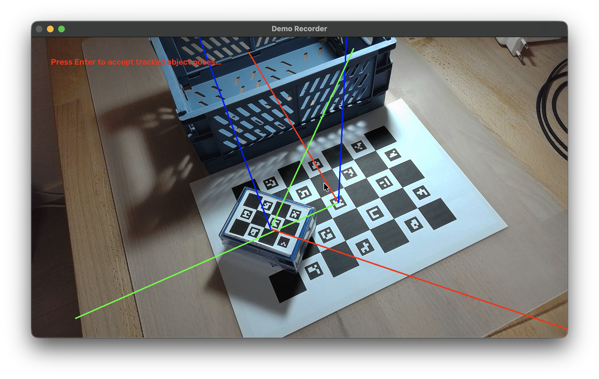

# Humanoid Intern Challenge - Robot Learning

I focused my project on a clean transition from low-quality data collected in the real world, to polished training data suitable for VLA finetuning. In particular this means acquiring robotic observation and action data, i.e. joint position / cartesian observations, actions, and most importantly camera images from a table and/or wrist perspective.

To gain this data I laid out the following pipeline:
1. Using two calibrated cameras, record manipulation videos of a human hand manipulating objects, including ChArUco boards placed on the table and fixed on the objects for aquiring a world origin and initial object poses.
2. Perform 2D landmark detection of the hand's fingertips in both camera views using the mediapipe library, and use them to triangulate 3D keypoints
3. Retarget the 3D keypoints to gripper poses and open/close actions
4. Obtain robotic observation data by replaying the recorded gripper trajectories in a RoboSuite-based Franka Panda simulation, where the manipulated objects are set to the captured initial poses at the start of each demonstration

The resulting dataset can then be used as training data to finetune VLA models.

Due to time constraints, I could unfortunately not fully complete the project. The pipeline laid out above is available and generally working, but a better retargeting strategy for gripper open/close commands and probably some smoothing operations would be needed for succesful trajectory replay. I also planned on testing the system on a finetuned pi0.5 VLA-policy.

Below you can find example images/videos of the pipeline in action, as well as installation and usage instructions.

## Examples




https://github.com/user-attachments/assets/28a4de9b-9152-4f41-8664-51661631769b

## Installation

The system has been tested on Mac, but should also work on Linux.

Two separate conda environments are required:
- **humanoid-intern-challenge-data** is used for collecting the real-world demonstrations
- **humanoid-intern-challenge-sim** is used for replaying the collected demonstrations in simulation

Create **humanoid-intern-challenge-data**:
```bash
conda env create -f environment_data.yml
```

Create **humanoid-intern-challenge-sim**:
```bash
conda env create -f environment_sim.yml

# Install robosuite
git clone https://github.com/ARISE-Initiative/robosuite.git robosuite-src
python -m pip install -e ./robosuite-src

# Test the robosuite installation
python robosuite/demos/demo_random_action.py # (use mjpython on Mac)
```

## Usage

First, you need to calibrate two (or three, see below) cameras:
- Print out assets/Charuco_Board.pdf and fix to a stiff, planar board
- For each camera, configure the variables [CALIBRATION_FILEPATH, CAMERA_DEVICE_ID, CAMERA_WIDTH, CAMERA_HEIGHT] at the top of scripts/demonstrations/calibrate_camera.py for your camera. Run:
```bash
(humanoid-intern-challenge-data)  python scripts/demonstrations/calibrate_camera.py
```
which will open the camera and start taking pictures of the charuco board if in view. Hold the board in the camera's view and move it around while it is taking pictures, making sure to cover the entire camera view. The script will generate a calibration file.

Next, print out assets/Objects_Charuco_Boards.pdf and cut out individual boards. Fix them to objects you want to manipulate (they boards must stay planar). Then, print out assets/Charuco_Board.pdf again and fix it on a table. Position the calibrated cameras so they both have a view on the board fixed on the table, and will also be able to see your hand performing the demonstrations.

Now you are ready to record demonstrations. You will first need to apply chagnes to demo/config.toml where required. Then, run:
```bash
(humanoid-intern-challenge-data)  python scripts/demonstrations/record_demonstrations.py --config "demo/config.toml" --dataset "demo/my_dataset.hdf5" --prompt "Place the box in the bin." --num 10
```
to record 10 demonstrations to "demo/my_dataset.hdf5". You will need to press Enter multiple times to confirm detected origin and object poses, and also to start and stop single demonstration recordings (this can be done as soon as the 3D viewer is visible, which must have focus for the Enter to register).

The recorded dataset can now be replayed in the simulation and thereby converted to a robotic dataset. Run:
```bash
(humanoid-intern-challenge-sim)  python scripts/simulation/replay_demos_in_simulation.py --input "demo/my_dataset.hdf5" --output "demo/my_sim_dataset.hdf5" --control_frequency 20
```

Finally, you can view the camera observations of the converted dataset by running:
```bash
(humanoid-intern-challenge-sim)  python scripts/simulation/view_simulation_dataset_videos.py --dataset "demo/my_sim_dataset.hdf5" --loop
```
